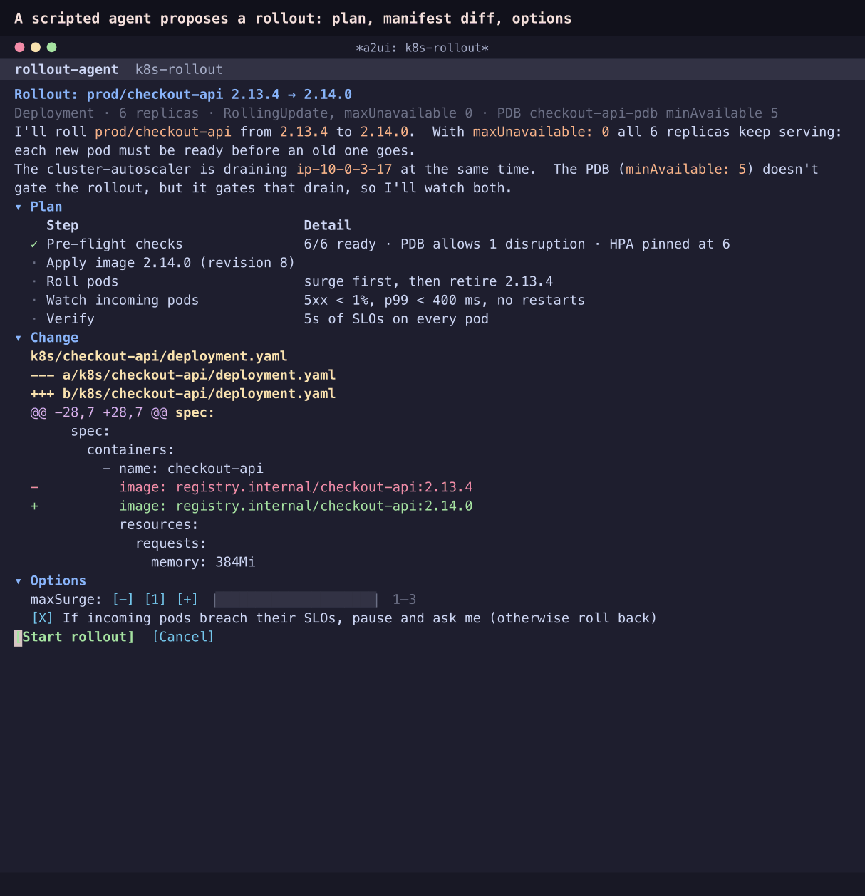
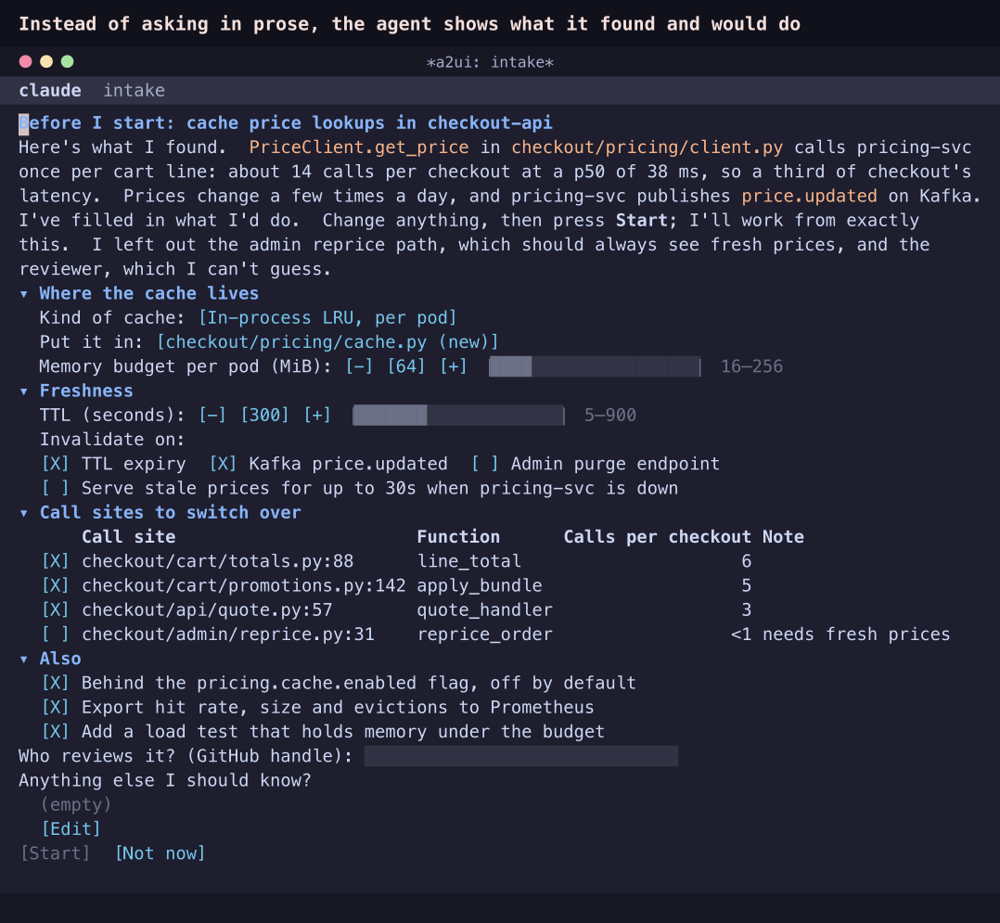
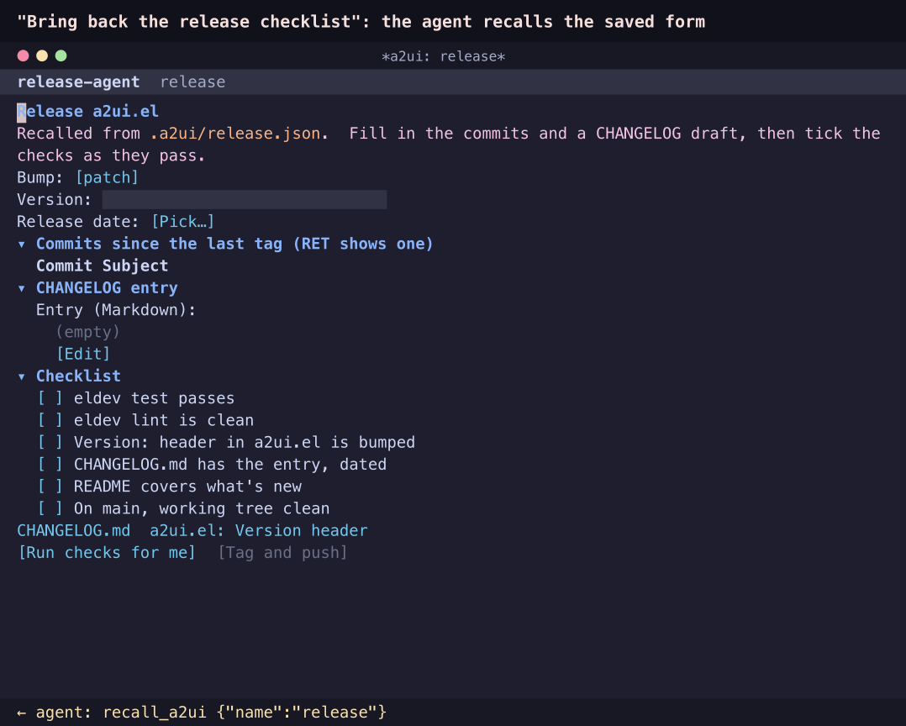
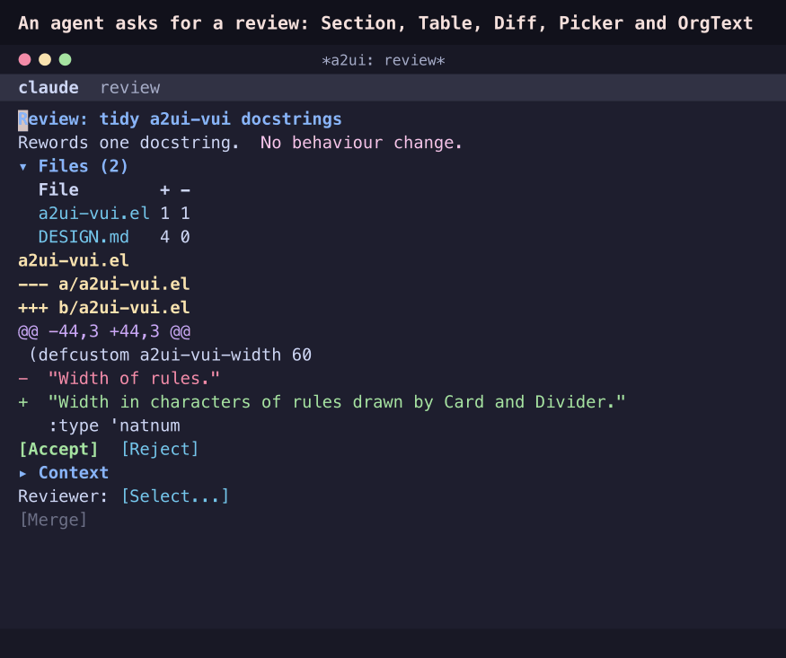

# Examples

None of these need an agent or an API key. Each GIF is recorded from the real renderer in batch Emacs (see [Recording the GIFs](#recording-the-gifs)), so it shows what you get.

## A Kubernetes rollout, live



```elisp
(load "/path/to/a2ui.el/examples/k8s-rollout.el")
M-x a2ui-example-k8s-rollout
```

A scripted agent rolls `prod/checkout-api` from 2.13.4 to 2.14.0 on a simulated cluster. The cluster has deployment and ReplicaSet controllers, a kubelet, and a cluster-autoscaler draining a node at the same time. The agent runs everything through one surface that updates every second:
- the plan, with each step's status
- the ReplicaSets
- every pod's status, readiness, restarts and memory against its limit
- telemetry for the outgoing and incoming pods, with sparklines
- the PodDisruptionBudget
- the event stream

2.14.0's new in-process cache runs its pods out of memory. The agent pauses the rollout and adds a decision card with three choices:
- accept a patch raising the memory limit, which rolls out a new ReplicaSet
- resume as is
- roll back

While pods crash, too few are healthy for the PDB's `minAvailable: 5`, so it blocks the autoscaler's drain until they recover. A PDB gates evictions like that drain, not the Deployment's own rollout; `maxUnavailable: 0` protects the rollout.

RET on a pod sends `describe_pod`, and the agent adds a `kubectl describe` view that stays live. You can also pause or roll back while the rollout runs. If you untick "pause and ask me", the agent rolls back on its own.

The agent sends its components once. After that it only sends data, one update a second, made of three kinds of value:
- **numbers**, which the Progress bar and the Table's bar and sparkline columns draw
- **tones**, which colour the pod statuses, breached SLOs and the PDB
- **`/view` flags**, which the components' `visible` is bound to, so the decision card, the pod detail and the buttons come and go without resending components

## Asking questions with a form



```
M-x a2ui-replay-file RET examples/intake-form.jsonl RET
```

Instead of asking five questions in prose, the agent shows what it found and what it would do, as a form with its guesses filled in:
- a ChoicePicker for the kind of cache
- a Picker for where the cache goes
- Sliders for the memory budget and the TTL
- chips for how entries expire
- a selectable Table of call sites
- CheckBoxes for the extras

`[Start]` stays disabled until you name the reviewer it couldn't guess. It then sends everything as one action, with the resolved context.

It is set in the same service as the rollout: this is the cache that later runs out of memory, and the form asks for a memory budget up front.

## A saved release checklist



```
M-x a2ui-replay-file RET examples/release-checklist.jsonl RET
```

This is a2ui.el's own release form:
- the version bump, version and date
- the commits since the last tag (RET on one sends `show_commit`)
- an editable CHANGELOG draft
- checks that gate `[Tag and push]`

`[Run checks for me]` asks the agent to run them and tick what passes.

The form is also saved, with its data cleared, as [`.a2ui/release.json`](../.a2ui/release.json). An agent working in this repository finds it with `list_a2ui`. Ask it to *"bring back the release checklist"*, and it recalls the form and fills it in from `git log`, as the GIF shows. Passing `data` to `recall_a2ui` does both in one call. `scripts/save-release-ui.el` rebuilds the saved file from the example.

## A code review



```
M-x a2ui-replay-file RET examples/code-review.jsonl RET
```

A review surface built from the Emacs catalog's Section, Table, Diff, Code, Picker, FileRef and OrgText. `[Merge]` is blocked until you pick a reviewer.

`contact-form.jsonl` is the A2UI spec's contact form, which uses the basic catalog only.

## Agents

`agents/` has AG-UI test agents and the `drive-*.el` scripts that play the user against live agents. See [Connecting an agent](../README.md#connecting-an-agent).

## Recording the GIFs

```sh
eldev -p emacs --batch -l scripts/example-gifs.el -f a2ui-example-gifs   # frames into docs/
python3 scripts/demo-gif.py docs/k8s-rollout-frames.json docs/intake-form-frames.json docs/release-checklist-frames.json
```

`scripts/example-gifs.el` drives each example as a user would, and `scripts/demo-gif.py` draws the frames as an Emacs window with ImageMagick. The rollout's simulation is seeded, so every recording plays the same way. `test/a2ui-examples-test.el` plays the same paths, so the examples can't drift from the renderer unnoticed.
